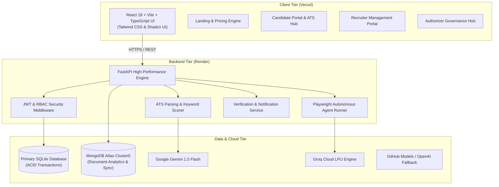

<div align="center">

# 🤖 AutoAgentHire
### Autonomous AI-Powered Hiring & Job Automation Ecosystem

[](https://fastapi.tiangolo.com)
[](https://react.dev)
[](https://www.typescriptlang.org)
[](https://vitejs.dev)
[](https://www.mongodb.com/atlas)
[](https://sqlite.org)
[](https://playwright.dev)
[](https://auto-agent-hire.vercel.app)
[](https://autoagenthire.onrender.com)
[](LICENSE)

<br />

**Connecting Talent with Opportunity Through Autonomous Intelligence**

[🌐 Live Frontend (Vercel)](https://auto-agent-hire.vercel.app) • [⚙️ Backend API (Render)](https://autoagenthire.onrender.com) • [📖 API Documentation](https://autoagenthire.onrender.com/docs)

</div>

---

## 🌟 Executive Summary

**AutoAgentHire** is a modern, enterprise-ready full-stack AI automation platform designed to bridge the gap between job candidates and recruiters. By fusing autonomous agent workflows, resume intelligence, and role-based governance, AutoAgentHire automates the tedious aspects of the modern job search while providing hiring teams with precision candidate evaluation.

* **For Candidates**: Autonomous multi-step job application automation, ATS resume scoring, keyword gap analysis, and tailored AI cover letter generation.
* **For Recruiters**: Dedicated portal for posting vacancies, reviewing candidate resumes, managing applicant statuses, and scheduling interviews with Pacific Time deadline controls.
* **For Organizations & Authorizers**: Multi-tenant RBAC governance requiring authoritative verification before employer accounts can access candidate dossiers.

---

## 🏗 System Architecture



---

## ✨ Core Platform Capabilities

### 1. 🤖 Autonomous Job Application Agent
* **Headless Browser Execution**: Leverages Playwright to navigate complex application workflows autonomously.
* **Adaptive AI Form Filling**: Identifies form labels, inputs candidate metadata, and utilizes LLM reasoning (Gemini/Groq/OpenAI) to craft concise, contextual answers for dynamic custom questions.
* **Deduplication Engine**: Employs an intelligent `FieldTracker` that prevents redundant inputs, suppresses infinite loops, and caches field determinations.

### 2. 🧾 Resume Intelligence & ATS Diagnostics
* **Multi-Format Extraction**: Parses PDF, DOCX, and TXT resumes to extract core skills, education, employment tenure, and biographical summaries.
* **Job Matching Matrix**: Compares resumes against job descriptions to produce quantified match scores, missing keyword alerts, and structural formatting tips.
* **Dynamic Cover Letters**: Synthesizes job description requirements and resume highlights to generate tailored cover letters in seconds.

### 3. 💼 Recruiter Management Portal
* **Job Posting Studio**: Create, edit, and publish job listings with salary bands, experience tiers, and Pacific Time application deadlines.
* **Applicant Pipeline**: Review candidate profiles, download verified resumes, update application stages (`applied`, `reviewing`, `shortlisted`, `rejected`), and schedule candidate interviews.
* **Authorizer Verification Protection**: Enforces an organization-level approval step prior to activating new recruiter workspaces.

### 4. 🛡 Enterprise Governance & Authorizer Control
* **Role-Based Access Control (RBAC)**: Distinct permissions partitioned for Candidates, Recruiters, and Authorizers.
* **Zero Data Leakage / IDOR Defense**: Strict user ownership verification ensuring candidates only see their own submissions and recruiters only see applications for their authorized postings.
* **Audit Trail**: Logs user actions, security status transitions, and agent runs.

### 5. 🗄 Resilient Dual-Database Architecture
* **SQLite Primary**: Provides lightweight, ACID-compliant local transactions with sub-second startup performance.
* **MongoDB Atlas Document Store**: Provides cloud synchronization (`autoagenthire` cluster) for multi-node deployments, document archives, and search queries with automatic TLS 1.3 verification and connection pooling.

---

## 📁 Repository Structure

```text
AUTOAGENTHIRE/
├── backend/
│   ├── api/                 # API router registrations and endpoints
│   ├── auth/                # JWT dependencies, hashing, and token handlers
│   ├── config.py            # Pydantic Settings and environment configuration
│   ├── database/            # SQLAlchemy models, SQLite connection, Mongo manager
│   ├── llm/                 # Gemini, Groq, and OpenAI service integrations
│   ├── parsers/             # Document parsers for PDF/DOCX resumes
│   ├── rag/                 # Vector embeddings and resume intelligence
│   ├── routes/              # Route handlers (auth, recruiter, ATS, agent, mongo)
│   ├── services/            # Email verification and background jobs
│   ├── build.sh             # Linux cloud build script for Render
│   └── main.py              # FastAPI application entry point and lifespan
│
├── frontend/
│   ├── public/              # Static assets, icons, and platform demo video
│   ├── src/
│   │   ├── components/      # Modular UI components (ATS, landing, layout, ui)
│   │   ├── hooks/           # Custom React hooks
│   │   ├── lib/             # API client (Axios) and utility helpers
│   │   ├── pages/           # Candidate, Recruiter, Authorizer, and Landing pages
│   │   └── services/        # Frontend API service layer
│   ├── package.json         # Frontend dependencies and build scripts
│   ├── vercel.json          # Vercel deployment and routing rules
│   └── vite.config.ts       # Vite bundler configuration
│
├── scripts/                 # Operational scripts (seed DB, test Mongo, health checks)
├── tests/                   # Pytest suite (data isolation, RBAC, IDOR tests)
├── .gitattributes           # Cross-platform LF line ending enforcement
├── .python-version          # Python 3.11.11 version pin
├── build.sh                 # Cloud build automation script
├── render.yaml              # Render infrastructure-as-code specification
├── requirements.txt         # Core Python framework dependencies
├── requirements-prod.txt    # Cloud-optimized production dependencies
└── vercel.json              # Monorepo Vercel routing configuration
```

---

## 🚀 Quickstart Guide

### Prerequisites
* **Python**: `3.11.x`
* **Node.js**: `18.x` or higher
* **npm**: `9.x` or higher
* **MongoDB Atlas** account (or local MongoDB)

### 1. Clone & Set Up Virtual Environment

```bash
# Clone the repository
git clone https://github.com/tteja121/AutoAgentHire.git
cd AutoAgentHire

# Create and activate Python virtual environment
python -m venv venv
.\venv\Scripts\activate      # Windows (PowerShell)
# source venv/bin/activate    # Linux / macOS

# Install backend dependencies
pip install --upgrade pip
pip install -r requirements.txt
playwright install chromium
```

### 2. Configure Environment Variables

Create `backend/.env` (or copy from `.env.example`):

```ini
APP_NAME=AutoAgentHire
APP_ENV=development
DEBUG=true
PORT=8000
SECRET_KEY=your-secure-32-character-secret-key

# MongoDB Atlas
MONGODB_URI=mongodb+srv://<user>:<password>@cluster0.amc4psk.mongodb.net/autoagenthire?retryWrites=true&w=majority
MONGODB_DB_NAME=autoagenthire

# AI APIs
GEMINI_API_KEY=your-gemini-api-key
GROQ_API_KEY=your-groq-api-key
OPENAI_API_KEY=your-openai-api-key

# CORS
CORS_ORIGINS=http://localhost:5173,http://localhost:8000,https://auto-agent-hire.vercel.app
```

### 3. Start the Backend Server

```bash
python -m uvicorn backend.main:app --host 127.0.0.1 --port 8000 --reload
```
* Interactive API Documentation (Swagger): `http://127.0.0.1:8000/docs`
* Health Endpoint: `http://127.0.0.1:8000/health`

### 4. Start the Frontend Application

In a separate terminal:

```bash
cd frontend
npm install
npm run dev
```
* Web Application: `http://localhost:5173` (or `http://localhost:8080`)

---

## 🧪 Testing & Verification

AutoAgentHire includes an automated security test suite that validates role separation, IDOR protection, and cross-account data isolation:

```bash
# Run security and data isolation tests
pytest tests/test_data_isolation.py -v

# Verify MongoDB Atlas live connectivity
python scripts/test_mongo_connection.py
```

---

## 🌐 Production Cloud Deployment

### Backend (Render)
* **Service Type**: Web Service
* **Build Command**: `bash ./build.sh`
* **Start Command**: `python -m uvicorn backend.main:app --host 0.0.0.0 --port $PORT`
* **Environment**: Python 3.11 (`.python-version` included)
* **Configuration**: Defined declaratively in [`render.yaml`](file:///c:/Users/mryte/OneDrive/Desktop/AUTOAGENTHIRE/render.yaml).

### Frontend (Vercel)
* **Framework**: Vite
* **Root Directory**: `frontend`
* **Build Command**: `npm run build`
* **Output Directory**: `dist`
* **Environment Variables**:
  * `VITE_API_URL`: `https://autoagenthire.onrender.com`
  * `VITE_API_BASE_URL`: `https://autoagenthire.onrender.com`

---

## 📄 License

This project is licensed under the **MIT License** — see the [LICENSE](LICENSE) file for details.

<div align="center">
<sub>Built with precision for the modern future of autonomous recruiting.</sub>
</div>