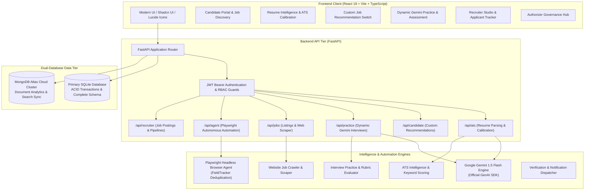

<div align="center">

# 🤖 AutoAgentHire
### Autonomous AI-Powered Hiring, Job Automation & Technical Assessment Ecosystem

[](https://fastapi.tiangolo.com)
[](https://react.dev)
[](https://www.typescriptlang.org)
[](https://vitejs.dev)
[](https://ai.google.dev/)
[](https://www.mongodb.com/atlas)
[](https://sqlite.org)
[](https://playwright.dev)
[](https://tailwindcss.com)
[](LICENSE)

<br />

**Empowering Talent and Hiring Teams with Autonomous Agents, Deep Resume Intelligence, Dynamic Technical Practice, and End-to-End Application Automation.**

[📂 GitHub Repository](https://github.com/tteja121/AutoAgentHire) • [⚙️ Backend API Docs (Swagger)](http://127.0.0.1:8000/docs) • [🌐 Frontend Application](http://localhost:5173)

</div>

---

## 🌟 Executive Summary

**AutoAgentHire** is an enterprise-grade, full-stack AI recruitment and career automation platform. Engineered with a high-performance **FastAPI** backend and a responsive **React 18 + TypeScript + Tailwind CSS** frontend, the platform unifies four critical pillars of modern hiring:

1. **Autonomous Application Execution**: Headless browser automation powered by Playwright and LLM reasoning that autonomously fills out multi-step job application portals.
2. **Deep Resume Intelligence & ATS Diagnostics**: High-accuracy parsing of PDF, DOCX, and TXT resumes, generating quantitative ATS match scores, missing keyword alerts, structural feedback, and tailored cover letters.
3. **Customizable Job Discovery & Profile Synchronization**: Toggle-driven recommendation engine allowing candidates to effortlessly transition between automated resume-based suggestions and custom criteria (skills, target roles, experience tier, workplace type, and location).
4. **Dynamic AI Practice & Interview Assessment**: Interactive mock interview simulations powered by **Google Gemini 1.5 Flash**, generating dynamic questions derived directly from candidate resume skills and target job specifications with real-time rubric evaluation.
5. **Role-Based Governance (RBAC)**: Partitioned workspaces for Candidates, Recruiters, and Authorizers with IDOR defense and data isolation.

---

## 🏗 Complete System Architecture



---

## 🔍 Comprehensive Feature Analysis & Programs

### 1. 🤖 Autonomous Job Application Agent
* **Headless Playwright Automation**: Navigates multi-step job boards, ATS portals (Greenhouse, Lever, Ashby, Workable), and enterprise career pages.
* **Intelligent Form Filler**: Extracts input labels, maps resume metadata to form inputs, and utilizes LLM reasoning to generate context-specific answers for custom employer questions.
* **FieldTracker Loop Suppression**: Implements deterministic tracking to prevent infinite submission loops, redundant inputs, and unnecessary DOM queries.
* **Real-Time Execution Logs**: Streams automation steps directly to the frontend console, providing transparency throughout the application workflow.

### 2. 🧾 Resume Intelligence & ATS Calibration
* **Multi-Format Ingestion**: Supports `.pdf`, `.docx`, and `.txt` files with clean text sanitization.
* **Safe Parsing Pipeline**: Employs robust extraction routines with built-in parameter validation, eliminating runtime text-binding errors.
* **ATS Compatibility Scoring**: Evaluates resume readability, formatting structure, contact information presence, and measurable achievement phrasing.
* **Keyword Gap Analysis**: Compares candidate resumes against target job descriptions, producing actionable lists of matched skills, missing keywords, and recommended additions.
* **Reset-on-Refresh State Lifecycle**: Employs session-level memory management (`activeResumeSession.ts`) to ensure browser refreshes present a clean, unpolluted upload interface without restoring stale resume states.
* **AI Cover Letter Generator**: Synthesizes job description requirements and verified candidate accomplishments into structured, professional cover letters.

### 3. 🎯 Customizable Job Recommendations
* **Seamless UI Switch**: Built with an interactive toggle switch on the Autonomous Agent page, allowing instant switching between "Resume & AI Intelligence" and "Customize Job Recommendations".
* **Zero-Flicker Animations**: Smooth slide-and-fade CSS transitions without layout jumps or page reloads.
* **Deep Filtering Parameters**:
  * **Skills**: Comma-separated or tag-based skill specifications (e.g., Python, React, AWS, Docker).
  * **Target Job Titles**: Multi-role targeting with flexible semantic matching.
  * **Experience Level**: Granular tiers (`Entry`, `Mid`, `Senior`, `Lead`, `Executive`).
  * **Workplace Preference**: `Remote`, `Hybrid`, and `On-site` filters.
  * **Location & Salary**: Location search combined with minimum salary expectation thresholds.
* **Bi-directional Profile Sync**: Custom parameters seamlessly synchronize with the candidate's persistent profile and the active recommendation engine.

### 4. 🧠 Dynamic Practice & Technical Assessment
* **Gemini-Powered Interview Simulation**: Generates customized interview questions on the fly using Google Gemini 1.5 Flash based on candidate resume strengths and target role domains.
* **Multi-Category Coverage**:
  * **Technical & Coding**: Language fundamentals, frameworks, algorithms, and architecture.
  * **System Design**: Scalability, distributed systems, caching, and database design.
  * **Behavioral & Leadership**: STAR-method leadership, conflict resolution, and communication.
* **Structured Evaluation Rubric**: Analyzes candidate answers against clear criteria, providing qualitative feedback, scoring metrics, and improvement recommendations.
* **Time Tracking & Performance Analytics**: Records time-spent-per-question, session durations, and overall assessment scores in type-safe SQLAlchemy ORM models.

### 5. 💼 Recruiter Management Studio
* **Job Posting Studio**: Create and update vacancies with salary ranges, experience tiers, skill requirements, and Pacific Time application deadlines.
* **Applicant Pipeline Management**: Review candidate profiles, inspect verified resumes, and advance candidates through configurable stages (`applied`, `reviewing`, `shortlisted`, `rejected`).
* **Interview Scheduling Hub**: Schedule interviews with candidates, automatically calculating Pacific Time schedules and dispatching notifications.
* **Authorizer Governance Guard**: Enforces organizational approval verification before recruiter accounts can publish live roles or access candidate dossiers.

### 6. 🛡 Enterprise Security & Architecture
* **Strict Role-Based Access Control (RBAC)**: Partitioned access scopes for `Candidate`, `Recruiter`, and `Authorizer` roles.
* **IDOR Defense & Data Isolation**: Database queries strictly filter by authenticated user IDs, preventing cross-tenant data leakage.
* **Google Gemini Key Security**:
  * Environment variables loaded securely from `backend/.env` with absolute directory resolution.
  * Key status check endpoint (`/api/ats/gemini-status`) reports configuration status without exposing credentials.
  * Graceful fallback to rule-based parsing if the Gemini API key is unconfigured.
* **Dual Database Resilience**:
  * **SQLite**: ACID transactions, local migrations, and fast development startup.
  * **MongoDB Atlas**: Cloud document synchronization, search indexing, and resilient data archives.

---

## 📁 Repository Directory Structure

```text
AutoAgentHire/
├── .github/workflows/          # CI/CD pipelines & GitHub Actions automation
├── backend/
│   ├── agents/                 # Autonomous agent state, graph nodes, and orchestrators
│   │   ├── nodes/              # Job search, matching, resume parser, and application nodes
│   │   ├── application_agent.py
│   │   ├── autoagenthire_bot.py
│   │   └── langgraph_orchestrator.py
│   ├── api/                    # Core API routers
│   ├── auth/                   # JWT creation, password hashing, and OAuth validators
│   ├── automation/             # Playwright automation, form filler, and LinkedIn auto-apply
│   ├── config.py               # Pydantic Settings & environment loader
│   ├── database/               # SQLAlchemy models (models_complete.py), SQLite & Mongo drivers
│   ├── integrations/           # Multi-ATS adapters (Greenhouse, Lever, Ashby, Workable)
│   ├── llm/                    # Gemini service (gemini_service.py) & multi-AI fallbacks
│   ├── matching/               # Profile matcher and job filter algorithms
│   ├── parsers/                # Multi-format document text extractors
│   ├── rag/                    # Vector store & resume intelligence
│   ├── routes/                 # FastAPI API route modules:
│   │   ├── agent_routes.py
│   │   ├── ats_routes.py
│   │   ├── auth_routes.py
│   │   ├── candidate_recommendations_routes.py
│   │   ├── cover_letter_routes.py
│   │   ├── email_routes.py
│   │   ├── integration_routes.py
│   │   ├── job_listings_routes.py
│   │   ├── linkedin_jobs_routes.py
│   │   ├── mongo_routes.py
│   │   ├── practice_routes.py
│   │   ├── recruiter_routes.py
│   │   └── website_import_routes.py
│   ├── services/               # Core business services:
│   │   ├── ats_intelligence_service.py
│   │   ├── email_service.py
│   │   ├── job_sync_service.py
│   │   ├── matching_service.py
│   │   ├── practice_service.py
│   │   └── website_job_crawler.py
│   ├── utils/                  # Logging, error handling, recruiter ID utilities
│   ├── requirements.txt        # Backend dependencies
│   ├── requirements-prod.txt   # Production backend dependencies
│   └── main.py                 # FastAPI application factory and lifespan
│
├── frontend/
│   ├── public/                 # Static assets, SVG icons, and favicons
│   ├── src/
│   │   ├── components/         # Reusable UI components (Shadcn UI, forms, cards)
│   │   ├── hooks/              # Custom React hooks (useJobAutomation, use-toast)
│   │   ├── lib/                # API client (Axios), Google OAuth, and utilities
│   │   ├── pages/              # Primary application views:
│   │   │   ├── dashboard/
│   │   │   │   ├── Applications.tsx      # Application tracking pipeline
│   │   │   │   ├── DashboardHome.tsx     # Candidate dashboard overview
│   │   │   │   ├── PracticePage.tsx      # Dynamic Gemini practice & assessments
│   │   │   │   ├── ProfilePage.tsx       # Candidate profile & preferences
│   │   │   │   └── ResumeParserPage.tsx  # ATS Calibration & Custom Recommendations
│   │   │   ├── AuthCallback.tsx          # OAuth callback handler
│   │   │   ├── AuthorizerPortal.tsx      # Employer account authorization
│   │   │   ├── Automation.tsx            # Autonomous agent control room
│   │   │   ├── CandidateJobsPage.tsx     # Curated job listings & search
│   │   │   ├── Index.tsx                 # Modern platform landing page
│   │   │   ├── Login.tsx / Signup.tsx    # Authentication pages
│   │   │   └── RecruiterPortal.tsx       # Recruiter jobs & applicant pipeline
│   │   ├── services/           # Frontend service modules (practice, jobs, ATS, auth)
│   │   ├── utils/              # Session resets (activeResumeSession.ts), profile sync
│   │   ├── App.tsx             # Route definitions and application shell
│   │   ├── index.css           # Tailwind CSS base and theme rules
│   │   └── main.tsx            # Vite React entry point
│   ├── package.json            # Node.js dependencies
│   └── vite.config.ts          # Vite configuration
│
├── scripts/                    # Database initialization and operational smoke checks
├── tests/                      # Automated test suite (security, ATS, Gemini, practice)
├── .dockerignore               # Docker build exclusions
├── .gitignore                  # Production hardened Git exclusion rules
├── Dockerfile                  # Container definition
├── LICENSE                     # MIT License
└── README.md                   # Complete system documentation
```

---

## ⚡ Quickstart & Local Setup

### System Prerequisites
* **Python**: `3.11.x`
* **Node.js**: `18.x` or higher
* **npm**: `9.x` or higher
* **Git**: Installed and configured

---

### Step 1: Clone the Repository

```bash
git clone https://github.com/tteja121/AutoAgentHire.git
cd AutoAgentHire
```

---

### Step 2: Backend Setup & Environment Configuration

1. **Create and activate a virtual environment**:
   ```bash
   # Windows (PowerShell)
   python -m venv .venv
   .\.venv\Scripts\activate

   # Linux / macOS
   python3 -m venv .venv
   source .venv/bin/activate
   ```

2. **Install dependencies**:
   ```bash
   pip install --upgrade pip
   pip install -r requirements.txt
   playwright install chromium
   ```

3. **Configure Environment Variables**:
   Copy the example environment template to `backend/.env`:
   ```bash
   cp backend/.env.example backend/.env
   ```

   Edit `backend/.env` with your settings:
   ```ini
   APP_NAME=AutoAgentHire
   APP_ENV=development
   DEBUG=true
   PORT=8000
   SECRET_KEY=your-secure-32-character-secret-key-here

   # Google Gemini API Key (Enables live AI resume intelligence and dynamic interview practice)
   GEMINI_API_KEY=your_gemini_api_key_here

   # Optional Multi-AI Fallbacks
   GROQ_API_KEY=your_groq_api_key_here
   OPENAI_API_KEY=your_openai_api_key_here

   # Primary Database (SQLite)
   SQLITE_DB_PATH=./autoagenthire.db

   # Document Database (MongoDB Atlas - Optional)
   MONGODB_URI=mongodb+srv://<username>:<password>@cluster0.example.mongodb.net/autoagenthire?retryWrites=true&w=majority
   MONGODB_DB_NAME=autoagenthire

   # CORS Allowed Origins
   CORS_ORIGINS=http://localhost:5173,http://localhost:8000,http://127.0.0.1:5173,http://127.0.0.1:8000
   ```

4. **Initialize Database Tables**:
   ```bash
   python scripts/setup_db.py
   ```

5. **Start the FastAPI Backend**:
   ```bash
   python -m uvicorn backend.main:app --host 127.0.0.1 --port 8000 --reload
   ```
   * **API Docs (Swagger UI)**: [http://127.0.0.1:8000/docs](http://127.0.0.1:8000/docs)
   * **Health Check**: [http://127.0.0.1:8000/health](http://127.0.0.1:8000/health)
   * **Gemini Key Status**: [http://127.0.0.1:8000/api/ats/gemini-status](http://127.0.0.1:8000/api/ats/gemini-status)

---

### Step 3: Frontend Setup

Open a new terminal window:

```bash
cd frontend
npm install
npm run dev
```

* **Frontend Web Application**: [http://localhost:5173](http://localhost:5173)

---

## 🧪 Testing Suite & Quality Assurance

AutoAgentHire maintains an automated test suite verifying security, API integrity, and AI features:

```bash
# Run complete test suite
pytest tests/ -v

# Run candidate isolation and IDOR security tests
pytest tests/test_data_isolation.py -v

# Run Gemini practice and dynamic question tests
pytest tests/test_dynamic_gemini_practice.py -v

# Run ATS intelligence and resume parsing tests
pytest tests/test_ats_intelligence.py -v

# Run Gemini environment configuration tests
pytest tests/test_gemini_config.py -v
```

---

## 🔒 Security & Git Hygiene Standards

This repository adheres to strict DevOps and security best practices:
* **Zero Secrets Committed**: All `.env`, `.env.local`, and credential files are strictly excluded via `.gitignore`.
* **Zero Database Binaries**: Local SQLite databases (`*.db`, `*.sqlite3`) are ignored.
* **Zero Candidate PII Stored**: Candidate resume uploads (`uploads/resumes/`) and generated temporary documents are permanently ignored.
* **Safe Configuration Templates**: Sanitized reference configurations (`.env.example`, `backend/.env.example`, `frontend/.env.example`) provide exact setup parameters without leaking private credentials.

---

## 📄 License & Attribution

This project is licensed under the **MIT License** — see the [LICENSE](LICENSE) file for complete details.

<div align="center">
<sub>Designed and engineered for the next generation of autonomous career enablement and recruitment intelligence.</sub>
</div>
